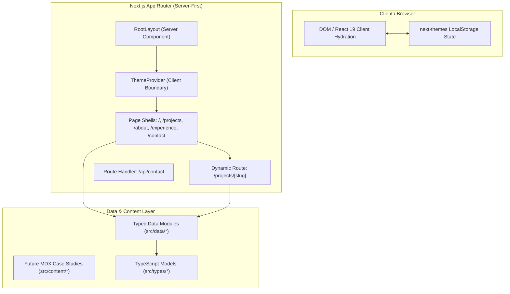

# Architecture & Technical Design

This document details the architectural foundation, design principles, and engineering patterns implemented in the portfolio application for **Habtamu Befekadu**.

---

## 1. High-Level Architecture

The portfolio is built as a lightweight, modern web application on the **Next.js App Router** leveraging **React 19** and **TypeScript strict mode**. It is architected specifically for high performance, zero superfluous server runtime dependencies, exceptional SEO, and rapid deployment on **Vercel**.

---

## 2. Server and Client Component Boundaries

The architecture enforces the **Server Components by default** paradigm:

- **Server Components (Default):**
  - All page roots (`src/app/**/page.tsx`)
  - Root layout shell (`src/app/layout.tsx`)
  - Static presentational wrappers (`PageContainer`, `Container`, `SectionWrapper`, `SectionHeading`)
  - Project showcase grids, cards, and career lists (`ProjectCard`, `ProjectGrid`, `Hero`, `FeaturedProjects`, `AboutPreview`, `SkillsPreview`, `ContactCTA`)
  - **Benefits:** Minimal client JavaScript bundles, faster First Contentful Paint (FCP), enhanced security, and direct server rendering.

- **Client Components (`"use client"`):**
  - Only components that require browser APIs, event listeners, or client-side React state are designated as Client Components:
    - `src/providers/ThemeProvider.tsx`: Wraps `next-themes` context.
    - `src/components/layout/ThemeToggle.tsx`: Handles theme toggling with hydration safety via `useSyncExternalStore`.
    - `src/components/layout/MobileNav.tsx`: Handles mobile drawer open/close state, escape key events, and route change tracking.
    - `src/components/projects/ProjectFilters.tsx`: Handles client-side category filtering tabs.
    - `src/app/error.tsx`: Next.js client-side error boundary.

---

## 3. Data Flow & Content Architecture

To prevent vendor lock-in, eliminate unnecessary database costs, and keep deployments atomic:

1. **Centralized TypeScript Types (`src/types/`):**
   - Independent interfaces define schemas for `Profile`, `Project`, `SkillCategory`, `Experience`, `Education`, `Certification`, and `SocialLink`.
   - Strict typing prevents runtime property errors and standardizes data contracts across components.

2. **Decoupled Data Layer (`src/data/`):**
   - Content is stored in typed TypeScript modules (`profile.ts`, `projects.ts`, `skills.ts`, etc.).
   - Access is abstracted behind pure query functions (e.g., `getProjects()`, `getFeaturedProjects()`, `getProjectBySlug(slug)`, `getExperiences()`).
   - Components consume data exclusively through these accessor functions, meaning the underlying storage could later be swapped for an API or headless CMS without modifying presentational components.

3. **Graceful Empty State Handling:**
   - Every list, showcase, and detail view is resilient against empty datasets.
   - When no projects, career records, or skills are present, the UI renders the accessible `EmptyState` component rather than breaking or throwing null pointer exceptions.

4. **Future MDX Case Studies (`src/content/projects/`):**
   - Reserved directory for deep-dive project postmortems and architectural breakdowns using MDX.

---

## 4. Design System & Theme Architecture

The application implements a strict **monochrome black-and-white design system**:

### Color Tokens

| Token                | Light Theme (Default)           | Dark Theme                      |
| :------------------- | :------------------------------ | :------------------------------ |
| `--background`       | `#FFFFFF`                       | `#000000`                       |
| `--foreground`       | `#000000`                       | `#FFFFFF`                       |
| `--primary`          | `#000000` (White text)          | `#FFFFFF` (Black text)          |
| `--secondary`        | `#FFFFFF` (Black border & text) | `#000000` (White border & text) |
| `--card`             | `#FFFFFF` (Subtle dark border)  | `#000000` (Subtle light border) |
| `--border`           | `rgba(0, 0, 0, 0.14)`           | `rgba(255, 255, 255, 0.18)`     |
| `--muted`            | `#F4F4F5`                       | `#18181B`                       |
| `--muted-foreground` | `#52525B`                       | `#A1A1AA`                       |

### Rules & Constraints

- **Zero Decorative Colors:** No gradients, colorful drop shadows, purple accents, or blue hyperlinks.
- **Typography:** Self-hosted `Geist Sans` for primary user interface copy and `Geist Mono` for metrics, code snippets, tags, and dates.
- **Hydration Safe:** Light mode is configured as the default. The `ThemeProvider` avoids layout shifts and suppresses hydration warnings on the `<html>` element.

---

## 5. Routing Architecture & Error Handling

- **Static Pages:** `/`, `/about`, `/projects`, `/experience`, `/contact` are statically pre-rendered at build time.
- **Dynamic Project Details:** `/projects/[slug]` dynamically resolves project slugs. Unknown slugs gracefully invoke Next.js `notFound()`, triggering the dedicated 404 handler.
- **Error Boundaries:** `src/app/error.tsx` catches runtime rendering errors within any route subtree and presents an actionable recovery UI with a "Try Again" trigger.
- **Loading State:** `src/app/loading.tsx` presents a monochrome spinner during async streaming.

---

## 6. Future API Integration (Contact Route)

The endpoint `src/app/api/contact/route.ts` is scaffolded as an architectural boundary:

- Currently returns an explicit **HTTP 501 Not Implemented** JSON response to prevent false expectations.
- In Phase 4, this endpoint will be integrated with an email provider (such as Resend or AWS SES) and request validation (using Zod) without changing frontend contracts.
